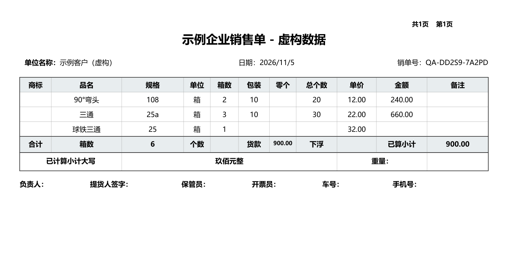
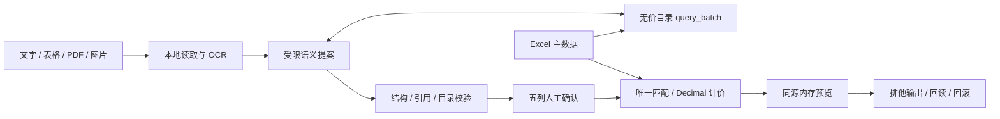

# Quote Assistant｜询价助手 · 脱敏公开版

将非结构化询价整理为可核对、可追溯的报价草稿。AI 负责提出候选，程序校验产品和金额，用户确认后才生成销售单。

**由作者自研企业报价项目整理的脱敏公开版，用于求职展示。企业名称、客户信息、真实价格和原始单据已移除，内置数据完全虚构。无需 API Key 或 OCR 模型即可体验完整离线流程。**



## 这个项目解决什么问题

询价可能来自聊天文字、Excel、扫描件或手写图片。同一商品存在不同叫法，规格、等级和数量容易混淆，直接让模型生成价格难以保证正确性。本项目把语义提案和确定性报价分开，并保留人工确认、原始证据和失败状态。

## 可体验的功能

- **完整离线演示**：固定合成询价 → 本地目录工具查询 → 提案验证 → 五列人工确认 → 查价 → 内存预览 → PDF 与逐页 PNG。
- **AI 接口实现**：文字、TXT、XLSX、PDF 和图片接入同一提案流程；图片先做本地 OCR，再提交文字。真实调用需自行配置 API 凭据，图片还需安装可选 OCR 环境。
- **业务校验**：产品、分类、规格和等级唯一匹配；保留歧义；`a` / `A` / `b` 区分；禁止猜价或跨档回退。
- **金额与输出**：`Decimal` 逐行向上取整；缺价格行不导出；缺包装行保留但只显示已计算小计；排他写入、回读和失败回滚。
- **状态与证据**：主数据 SHA-256 改变会使旧报价失效；保留原文字段、逐项引用、工具调用与本地诊断。

离线回放不衡量模型准确率。此仓库不包含客户原件、企业价格、完整商业目录、既有销售单、密钥、模型权重或原项目 Git 历史。

## 原项目效果与统计口径

作者报告：在原企业数据与单据的历史测试中，**非手写字段正确率 100%，手写字段正确率 90%**。统计单位为字段，不是整单全对率，也不是价格或最终报价正确率。相关企业数据不随本脱敏版公开。

本次整理找到了早期 OCR 和模型对照报告，但尚不能从这些不同阶段的记录复算上述两个汇总值；因此保留为作者确认的历史业务测试结果，不标作本公开版已复现的基准成绩。可核对的样本范围、差异与限制见 [评测说明](docs/EVALUATION.md)。公开版的合成数据用于复现流程和软件回归，人工核对与出单门禁仍然保留。

## 五分钟运行

使用 Python 3.11。以下命令在仓库根目录执行。

Windows 建议放在较短路径（例如 `C:\dev\quote-assistant`），再创建虚拟环境；深层目录可能让 Streamlit 依赖安装超过 Windows 路径长度限制，出现 `No such file or directory`。

```bash
python -m venv .venv
```

Windows PowerShell 激活：`.\.venv\Scripts\Activate.ps1`；macOS / Linux 激活：`source .venv/bin/activate`。如 PowerShell 不允许激活，可直接使用 `.\.venv\Scripts\python.exe` 替代后面的 `python`。

```bash
python -m pip install -r requirements.txt
python scripts/create_demo_data.py
python -m streamlit run app.py
```

打开 [本地页面](http://127.0.0.1:8501)，依次点击：

1. **加载离线演示**：回放固定合成提案，不调用模型，也不读取上传的内容。
2. **确认识别结果**：核对分类、产品名、规格、箱数和等级。
3. **匹配标准主数据**：演示客户名称已填入，自动显示销售单预览。
4. **生成销售单**：下载 PDF 和 PNG。

示例三行中的前两行合计 **900.00 元**，第三行故意缺少包装数，因此只能显示“已计算小计”。所有价格、包装、重量和数量都是测试数值。

初始化脚本从代码生成 22 条合成记录及空白结构模板，遇到现有工作簿会保留它。生成文件和运行数据均被 Git 忽略。Windows 默认使用系统中文字体；无该字体时使用 PyMuPDF 自带 CJK 字体，不需要复制字体文件。

## 真实 AI 识别（可选）

在 [DeepSeek 控制台](https://platform.deepseek.com/) 创建 API Key，给启动进程设置 `DEEPSEEK_API_KEY`；`.env.example` 是变量说明，程序不自动加载 `.env`。请勿把真实凭据写进代码、截图或提交记录。

Windows PowerShell（已激活虚拟环境）：

```powershell
$credential = Read-Host 'DeepSeek API Key' -AsSecureString
$env:DEEPSEEK_API_KEY = [System.Net.NetworkCredential]::new('', $credential).Password
python -m streamlit run app.py
# 服务退出后清除当前终端的变量
Remove-Item Env:DEEPSEEK_API_KEY
```

macOS / Linux Bash（已激活虚拟环境）：

```bash
read -rsp 'DeepSeek API Key: ' DEEPSEEK_API_KEY; echo
export DEEPSEEK_API_KEY
python -m streamlit run app.py
unset DEEPSEEK_API_KEY
```

先用合成文字试运行：`沟槽 90°弯头 108 2箱 b`。勾选外发确认后识别，核对五列，再匹配和出单。缺少密钥时会阻断真实识别；余额或接口失败会保留待处理提示。密钥必须设置在启动服务的同一终端，设置后重新启动服务才会生效。

默认模型为 `deepseek-flash`，接收方固定为 DeepSeek 官方 API。填写或上传内容后，核对发送提示、勾选允许外发，再点击“识别新询价”。每个文件及非空粘贴文字各最多两次请求；工具续轮及网络重试也计数。当前没有费用金额硬上限。

实现使用 `https://api.deepseek.com/chat/completions` 和 SSE 工具调用，无需安装额外的模型 SDK；不支持填写第三方代理地址。模型参数在 `src/agent_workflow.py`，请求限额在 `src/agent_inquiry.py`。配置与官方 [首次 API 调用文档](https://api-docs.deepseek.com/) 核对于 2026-11-05；真实调用产生的费用以提供方账单为准。

**发送范围**：文字 / 本地 OCR 结果、相关位置和无价商品目录。程序不发送原图、主表价格、包装或重量；但原始文字中的企业名、电话号码等不会自动移除。请只使用有权处理的内容。详见 [数据流与隐私](SECURITY.md)。

基础依赖支持离线演示和文本 / 表格读取。图片或带图 PDF 需要额外的 PaddleOCR-VL 运行环境与模型；按 [官方安装说明](https://www.paddleocr.ai/main/en/version3.x/pipeline_usage/PaddleOCR-VL.html) 为硬件选择 Paddle 版本。当前适配参数在 `src/ocr_pipeline.py`，默认 CPU、`pipeline_version="v1.6"`。Windows 建议使用纯英文 `PADDLE_PDX_CACHE_HOME`。本公开版未重新验收真实 OCR 推理或真实 API 识别，不能将接口存在视为准确率保证。

## 架构与代码入口



| 文件 | 职责 |
| --- | --- |
| `app.py` | Streamlit 页面、编辑状态、人工确认、外发提示和下载 |
| `src/agent_inquiry.py` | 多来源输入编排、提案转为待确认行、失败占位 |
| `src/agent_workflow.py` | 有限工具循环、流式响应完整性、请求记账和重试 |
| `src/agent_catalog.py` | 无价目录、参数白名单、分页、候选与快照校验 |
| `src/agent_context.py` | 分类及等级标题的页 / 列 / 来源作用域 |
| `src/core.py` | 主数据、唯一匹配、金额、PDF / PNG 和持久化 |
| `src/input_router.py`、`src/ocr_pipeline.py` | 文件读取、图片检查、本地 OCR；保留既有规则组件 |
| `src/demo.py` | 明确标识的固定合成提案回放 |
| `src/usage_diagnostics.py` | 本地证据、凭据遮盖和诊断包路径检查 |

进一步阅读：[架构取舍](docs/ARCHITECTURE.md) · [行为合同](docs/BEHAVIOR.md) · [验证记录与限制](docs/VALIDATION.md)

## 测试与发布检查

```bash
python -m pip install -r requirements-dev.txt
python scripts/create_demo_data.py
python -m pytest -q
python scripts/package_release.py
```

测试使用合成数据、模拟 API / OCR，并禁止网络连接。覆盖金额、歧义、档位、指纹失效、输出回滚、工具协议、输入异常、UI 确认流程和公开包门禁。GitHub Actions 配置提供 Windows / Ubuntu 的离线回归；实际执行记录以 Actions 为准。

`public-manifest.json` 记录人工审阅版本的文件哈希。内容变化后检查会阻断；应先审阅源码与截图，再更新对应哈希。可创建只包含这些文件的全新源码包：

```bash
python scripts/package_release.py --output ../quote-assistant-public.zip
```

请在独立空目录解压后建立全新 Git 仓库。不要把既有企业仓库改为公开，也不要导入其提交历史。作者已确认源码为本人编写；当前未选择代码开源许可证，依赖许可说明见 [第三方说明](THIRD_PARTY_NOTICES.md)。

GitHub 项目简介可使用：**企业询价与报价助手的脱敏公开版：本地 OCR、受限目录 Agent、人工确认与确定性计价，支持无需密钥的完整离线演示。历史字段正确率与统计边界见 README。**

## 当前边界

本项目定位为本地、单用户作品展示，不是已验收的生产服务。尚未提供登录、租户隔离、多进程写入协调、可靠任务中断或生产监控。刷新允许丢失草稿；诊断含输入内容，不自动清理。真实复杂询价准确率、跨机 OCR、实际打印和业务收益均未在此版验证。
